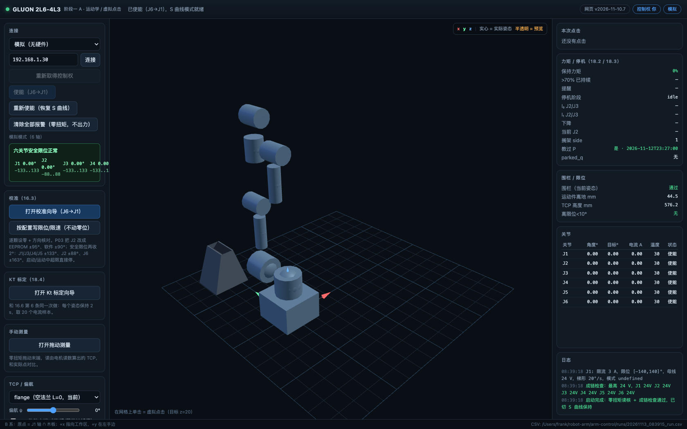

# GLUON 2L6-4L3 机械臂控制网页

浏览器里完成六轴运动学的预演 / 虚拟点击、点动、回零、停机、校准、Kt 标定和拖动测量。

执行器是一个独立的 Python 后台程序，网页只是它的一个客户端；所有电机命令都先经执行器做限位、围栏、力矩和控制权检查，再下发到 ECB/CAN。网页本身不直接发 UDP。



## 快速开始

需要 Python 3.10+ 和 numpy；three.js 已放在 `arm-control/web/vendor/`，不需要联网。

```bash
pip install -r requirements.txt

# macOS：双击“启动网页.command”，或：
./启动网页.command              # 真机，默认端口 8770
./启动网页.command --mock       # 无硬件模拟
./启动网页.command 8771         # 换端口
```

也可以手动启动：

```bash
cd arm-control
python3 -m arm.executor --port 8770
python3 -m arm.executor --mock --port 8770
```

然后打开 <http://127.0.0.1:8770/>。

## 真机注意

- 默认是**预演**模式；切“直接执行”、实际点动、回零都会二次确认。
- 操作前先把臂支撑/扶住，人站在直流空开旁；首次上电先读限位、确认零位和方向。
- 输出速度上限 20°/s；J1/J2 限流等参数在 `arm-control/config/joints.json`。
- “紧急全部失能”会立即断六轴使能，**臂会掉**；能用“停机/扶持停机”时优先用它们。
- 网页关掉执行器仍在跑；控制权是单 owner，另一个页面打开会显示只读。

## 功能

- 3D 预演、网格点击、末端三轴抓手拖动；目标限制在可达包络内。
- 回零：按需先“抬高”，再一步同步插补回 q=0；起点在围栏外时只允许拖动或回零。
- 点动 ±1°/±5°；“停”= 原地保持；运动中/拖动中有对应保护。
- 停机（搁架）/ 扶持停机 / 紧急全部失能；停机位置可在网页里记录。
- 校准向导（J6→J1）、写限位/限速、Kt 标定、零扭矩拖动测量。
- 运行时页面快照：每 100 ms 把当前按钮灰/亮、输入值、显示值写到
  `arm-control/runs/web_state.json`（只留最新一份），可用
  `GET /api/debug/page_state` 查看。
- 状态推送 20 Hz；心跳 200 ms；断线 0.5 s 中止保持、3 s 释放控制权。

## 目录

```text
启动网页.command          双击启动（真机/--mock）
arm-control/
  arm/                    执行器、运动层、运动学、围栏、关节、校准
  web/                    网页（three.js 已本地化）
  config/                 关节/末端/执行器/停机位置配置
  urdf/                   机械臂 URDF
  tools/                  零位、限位、自检等命令行工具（可选）
  models/                 临时针模型
docs/screenshot.png       README 截图
```

`runs/` 是运行时生成的 CSV/快照目录，不提交到仓库。

## 版本

- 网页：`v2026-11-13.1`
- 关节配置：`v2026-11-10.1`
- TCP 配置：`v2026-11-09.1`

`tools/probe_model.py` 另外需要 OCP/OpenCASCADE；只跑网页和执行器不需要。
